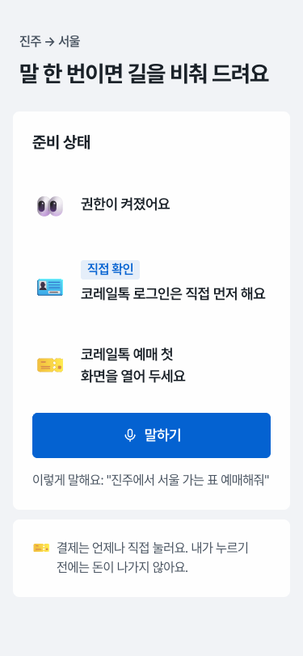
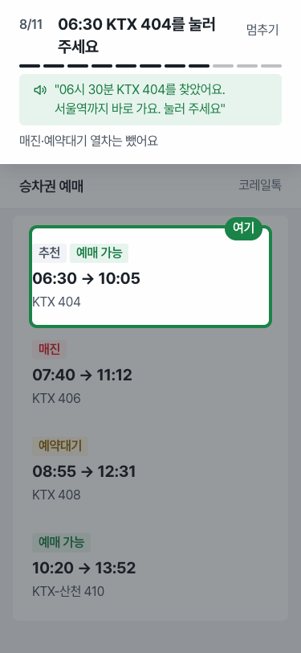
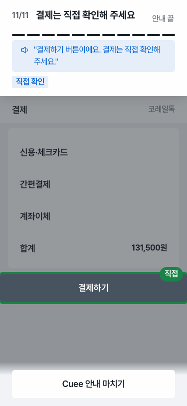
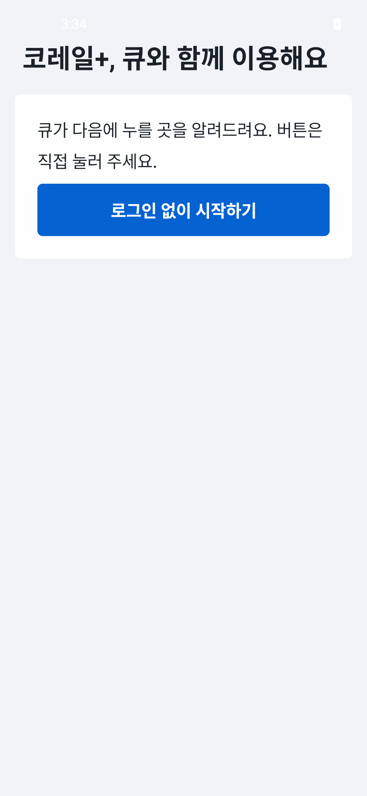
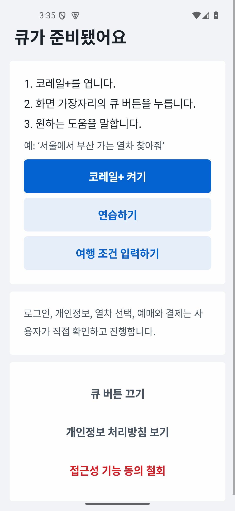
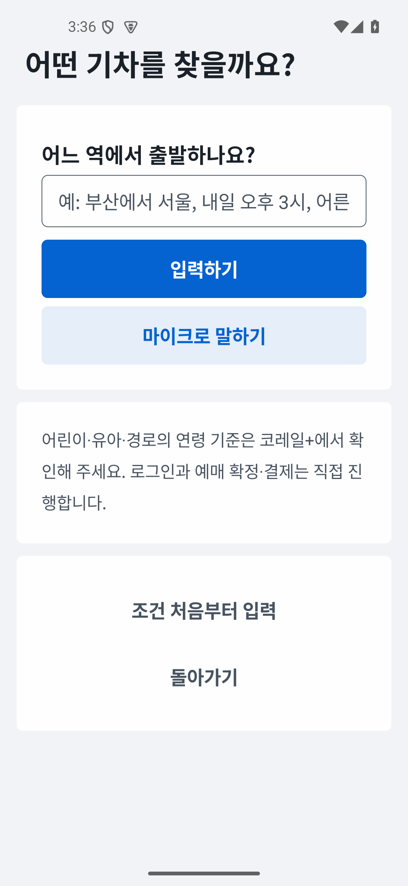
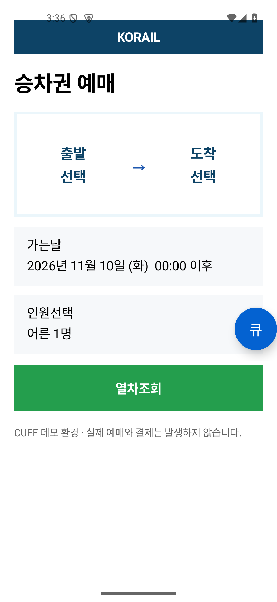

# UI 디자인 캔버스 제작과 앱 화면 리팩토링 (2026-11-06 ~ 11-10)

한 세션에서 한 일을 순서대로 정리한 기록이다. PRD(`docs/prd.md`)로 디자인 캔버스를 만들고, 그 캔버스의 시각 언어를 실제 앱 화면에 입혔다.

## 1. 한 일 요약

| 순서 | 한 일 | 결과물 |
|---|---|---|
| 1 | `k-style-ui-ux` 플러그인 설치 (vmc-inner-circle/k-style-ui-ux, v0.19.2) | `/k-style-ui-ux:go`, `/k-style-ui-ux:max` 명령 |
| 2 | PRD로 디자인 캔버스 1차 제작 (`go`) | `out/index.html` — 화면 14장 |
| 3 | 상태·예외 화면 추가 (`max`) | 오류 상태 9장 추가, 모두 23장 |
| 4 | 캔버스 기준으로 앱 화면 리팩토링 | `app/src/main/java/com/cuee/ui/`, `overlay/` |
| 5 | 엣지 케이스 점검 | 아래 5절 (아직 고치지 않음) |

## 2. 디자인 캔버스 (`out/`)

`out/index.html`을 브라우저로 열면 전체 화면을 한눈에 볼 수 있다. 위쪽 색 점 3개로 팔레트(굿닥 파랑·올리브영 초록·숨고 보라)를 바꿔 볼 수 있다.

**핵심 한 문장**: 말은 한 번, 누르는 건 내 손으로. 코레일톡 화면 위에 다음에 누를 곳 하나만 초록 테두리로 비추고, 결제하기 앞에서 안내를 멈춘다.

### 화면 구성 (23장)

| 묶음 | 기본 화면 | 오류 상태 |
|---|---|---|
| 처음 들어올 때 | 권한 켜기 | 접근성 서비스 꺼짐 |
| 말 한 번으로 시작 | 홈, 알아들은 말 확인 | — |
| 역·날짜·인원 안내 | 출발역, 진주 자동 입력, 날짜, 인원 | 로그인 안 됨, 자동 입력 실패, 날짜 잘못 누름, 어린이 인원 초과 |
| 열차 고르기 안내 | 조건 확인 후 조회, 추천 열차, 내일 표 없음, 안내 멈추기 | 도착역이 수서로 들어감, 11월 7·8일 모두 표 없음 |
| 예매에서 결제 앞까지 | 예매, 결제/발권, 결제하기 앞 정지 | 좌석이 이미 팔림, 동의 칸 미체크 |

| 홈 | 추천 열차 | 결제 앞 정지 | 자동 입력 실패 |
|---|---|---|---|
|  |  |  |  |

### 만들면서 정한 것

- **사람**: 핵심 사용자는 박영희(71세, 진주). 딸 이지은(43세)은 권한 켜기 화면에서만 주인공이다. 자세한 내용은 `out/journey.md`.
- **안전 규칙 반영**: 결제 화면의 "결제하기"는 강조만 하고 링크를 걸지 않았다. 로그인·약관·동의 칸은 강조하지 않고 글로만 안내한다.
- **코레일톡 화면**: 로고·브랜드 색 없이 회색 모형으로 그렸다.
- **시장 관례**: NOL·카카오 T·카카오맵·네이버지도·카카오톡을 참고했다. 길 안내 앱처럼 위쪽 띠에 다음 할 일을 크게 두는 것은 따랐고, 홈의 검색창·아이콘 격자·하단 탭은 따르지 않았다(홈에서 하는 일이 말하기 하나뿐이라서). 판정은 `out/decisions.json`.
- **가상 값**: 열차 번호·시각·운임(131,500원)은 시연용이다.

### 검사 결과

- 자동 검사(selfcheck): 통과.
- 렌더링 검사(audit): 49개 중 48개 통과. 남은 1개(글자 대비 3곳)는 공용 스타일을 고쳤지만 다시 돌려 확인하지 않았다.
- 사실 대조: 화면 글자와 `journey.md` 사실 표가 어긋나는 곳 없음.
- 건너뛴 것: 반대 입장 검토(서로 다른 사용자 둘 + PM 역할) 단계.

### 저장소에 올리지 않은 것

- `out/market/` — 다른 앱의 스토어 화면과 리뷰(참고 자료).
- `out/.shots/` — 검사용 캡처. 필요한 4장만 `docs/ui-refactor-2026-11-10/`에 복사했다.

## 3. 앱 화면 리팩토링

색은 캔버스의 굿닥 파랑(`#0462D1`)으로 정했다. 처음엔 초록(올리브영)으로 시작했다가 파랑으로 바꿨다. **문구와 동작은 그대로 두고 스타일만 바꿨다.**

캔버스는 PRD의 진주→서울 시연 흐름을 그린 것이고 실제 앱은 화면 구성이 달라서(코레일+, 큐 버튼, 연습 모드), 화면을 일대일로 옮기지 않고 시각 언어만 입혔다.

| 파일 | 바꾼 것 |
|---|---|
| `ui/CueUi.kt` (새 파일) | 두 화면이 같이 쓰는 공용 스타일: 회색 바탕 + 흰 블록, 큰 제목(28sp), 56dp 버튼 4종(주·보조·조용한·위험), 테두리 입력 칸 |
| `ui/MainActivity.kt` | 시작·동의·접근성 설정·홈·연습·개인정보 화면을 공용 스타일로 교체. 화면마다 파란 주 버튼은 하나. 홈의 "연습하기"는 보조 버튼으로, "동의 철회"는 빨간 글자로 |
| `ui/JourneyActivity.kt` | 같은 스타일 적용. 조건이 다 모이기 전에는 "입력하기"가, 다 모이면 "이 조건으로 안내 시작"이 주 버튼. 픽셀 단위 여백을 dp로 교체 |
| `overlay/OverlayUtils.kt` | 색 상수를 팔레트 토큰으로 정리(`CUE_BRAND`, `CUE_HIGHLIGHT` 등) |
| `overlay/BubbleOverlayController.kt` | 큐 버튼을 파랑으로 |
| `overlay/CandidateHighlighter.kt` | 누를 곳 테두리는 초록 유지, 2dp → 4dp |
| `overlay/GuideControlOverlayController.kt` | 안내 패널 버튼을 옅은 파랑 바탕으로, "종료"만 빨간 글자 |
| `overlay/MaskOverlayController.kt` | 마스크 색을 팔레트의 먹색 계열로 |
| `res/values/styles.xml` | 강조 색과 상태바·내비게이션 바 색을 팔레트에 맞춤 |

| 시작 | 홈 | 여행 조건 입력 | 코레일 모형 위 큐 버튼 |
|---|---|---|---|
|  |  |  |  |

안전 규칙(`domain/safety/`)과 안내 로직은 건드리지 않았다.

## 4. 확인한 것과 못 한 것

- 빌드(`assembleDebug`)와 단위 테스트(`testDebugUnitTest`): 통과. JDK 17로 실행했다(기본 JDK 25로는 빌드가 실패한다).
- 에뮬레이터(`cuee_demo_api35`)에서 캡처로 확인: 시작, 접근성 설정, 홈, 여행 조건 입력, 코레일 모형 위 큐 버튼.
- 컴파일만 확인하고 실제 모습은 보지 못한 것: 안내 패널, 초록 테두리, 마스크, 연습, 동의, 개인정보 처리방침 화면.
- 린트(detekt): 프로젝트 전체에 기존 경고가 많아 실패 상태다. 이번에 바꾼 파일에 남은 7건은 긴 문구 줄 4건과 구조 경고 3건이다.
- 캔버스의 "11단계 중 몇 번째" 진행 막대는 앱에 넣지 않았다.

## 5. 엣지 케이스 점검 (아직 고치지 않음)

1. **코레일+ 미설치**: "코레일+ 켜기"를 누르면 설명 없이 스토어로 넘어간다.
2. **안내 시작 시 접근성 꺼짐**: 조건 입력 화면에서 아무 말 없이 메인 화면으로 돌아간다.
3. **연습 중 마이크 권한 거부**: 같은 단계로 돌아갈 뿐 안내 문구가 없다.
4. **동의 철회**: 한 번 누르면 확인 없이 바로 철회된다.
5. **조건 입력 칸 예시 문구**: 한 줄이라 뒷부분이 잘려 보인다.
6. **안내 패널 버튼 4개**: "조건 수정"이 붙으면 칸이 좁아 글자가 두 줄로 꺾일 수 있다.
7. **첫 실행 상태바**: 시작 화면 첫 캡처에서 시계 글자가 흰색이라 밝은 배경에 잘 안 보였다.
